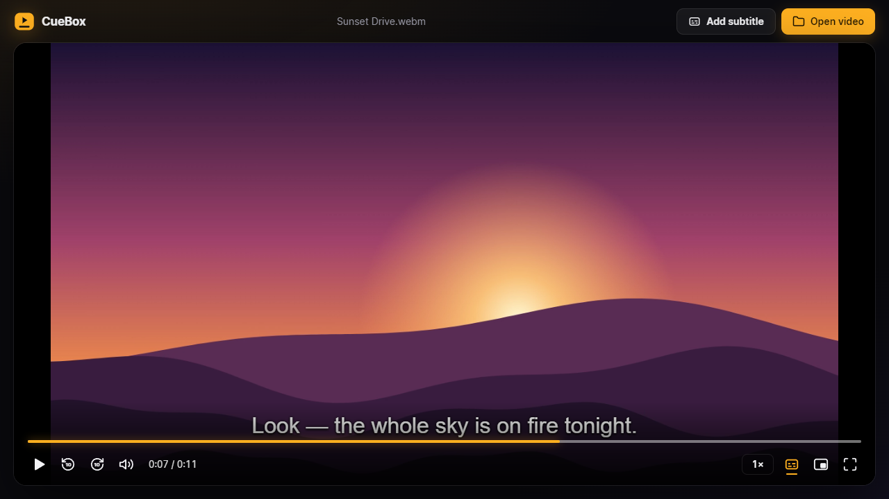
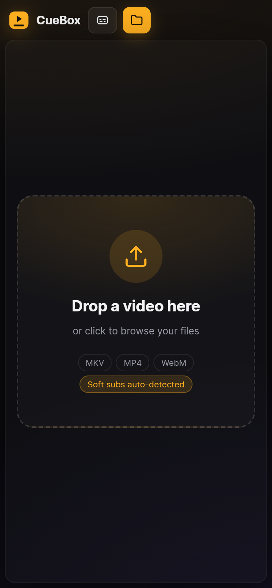
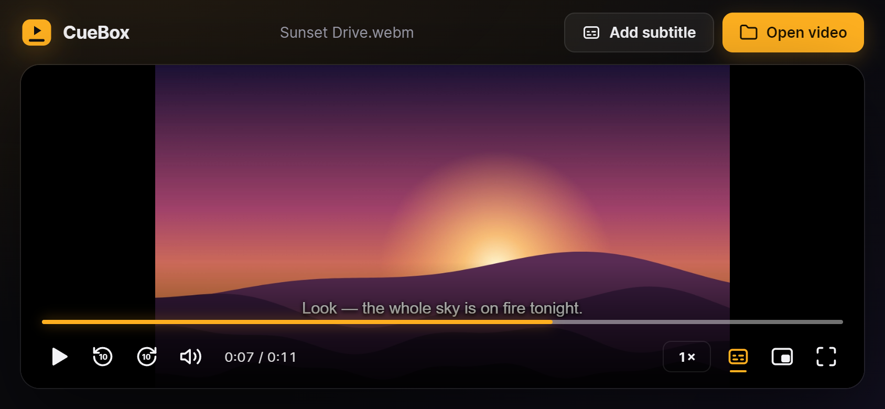

# CueBox

[](https://github.com/Alisky1223/CueBox/actions/workflows/ci.yml)
[](LICENSE)

**Drop a file, get your subtitles.** A zero-install offline video player that finds the soft subs inside your MKV files and shows them right away.



## Features

- **Open any local video.** Use the file picker or drag and drop the file onto the page.
- **Play from a link.** Paste a direct link to a video file and it streams without downloading the whole file first.
- **Embedded subtitles turn on automatically.** Text subtitle tracks (SRT/ASS/SSA/WebVTT) inside MKV/WebM files are read in the browser and shown at once, with no ffmpeg needed.
- **Add your own subtitles.** Load `.srt`, `.vtt`, `.ass` or `.ssa` files. Persian/Arabic files saved in Windows-1256 instead of UTF-8 also work.
- **Switch or turn off subtitles.** Pick any track from the subtitle menu, or choose **Off**. You can also change the subtitle size and background, and shift timing when subtitles are out of sync.
- **Switch audio tracks.** Videos with several audio tracks (for example, multiple dubs) get an audio menu. In MKV/WebM files, CueBox reads the chosen track itself, so this works in Chrome and Edge without any flags.
- **A polished player.** It has a dark cinematic theme, a seek bar that previews the time, speed control, picture-in-picture and fullscreen. Controls hide on their own while the video plays.
- **Watch together.** Pair with someone on another device using a short code, and play, pause, seeking and speed stay in sync. Each of you plays your own copy of the video.
- **100% offline.** Nothing is uploaded and there's nothing to install. The build is a single HTML file. Only **Watch together** and **Play from a link** need internet, and nothing of yours is ever sent anywhere.

## Usage

### Install on a computer (recommended)

Open [alisky1223.github.io/CueBox](https://alisky1223.github.io/CueBox/) in Chrome or Edge and click **Install** in the address bar. CueBox then:

- gets its own window, plus a Start menu and taskbar icon,
- works offline after the first visit,
- shows up in **Open with** for `.mkv`, `.mp4` and `.webm` files, and can be set as the default player,
- updates itself when a new version is released.

### Install on a phone

Open [alisky1223.github.io/CueBox](https://alisky1223.github.io/CueBox/) on your phone, then:

- **Android (Chrome):** tap the **⋮** menu, then **Install app** (on some phones it's called **Add to Home screen**), then **Install**.
- **iPhone/iPad (Safari):** tap **Share**, then **Add to Home Screen**, then **Add**. On iOS 16.4 or newer, Chrome and Edge have the same option in their Share menu.

CueBox gets a home-screen icon and opens full screen. Tap the folder button to pick a video from your phone. Like on a computer, it works offline after the first visit.

<p>
  
  
</p>

### Download a single file

Download `CueBox.html` from the [latest release](https://github.com/Alisky1223/CueBox/releases/latest), or build it yourself (see below). Then open it in Chrome or Edge. Double-clicking it works, with no server needed.

> The `index.html` in the repo root is the development source and won't run when opened directly. Use `dist/index.html` or `pnpm dev` instead.

### Play from a link

Paste a link into the box under **Drop a video here** and press **Play**. While a video is open, use **Open link** in the top bar or press `U`.

- The link must point straight to a video file (for example `https://example.com/movie.mp4`), not a web page such as YouTube.
- The video plays as a stream, so it starts right away.
- Embedded subtitles aren't loaded from links, since finding them means downloading the whole file. Add a subtitle file or a subtitle link instead.
- **Add subtitle from link…** (subtitle menu) needs a server that allows CORS. **Add audio from link…** (audio menu) plays a separate audio file, such as a dub, in sync with the video from any server. If the video's own server doesn't allow CORS, its original sound comes back only after reopening the video.
- Audio-track switching and the HEVC warning need to read the file itself. That works only if the server allows it ([CORS](https://developer.mozilla.org/docs/Web/HTTP/CORS) with range requests). Otherwise the video still plays.
- The online version runs over https, so `http://` links may be blocked by the browser.

### Watch together

1. You and your partner each open your own copy of the same video.
2. One of you clicks the **Watch together** button (two people) in the player controls, then **Create a code**, and sends the code to the other person.
3. The other person opens **Watch together**, types the code and clicks **Join**.

From then on, play, pause, seeking and speed changes on either side apply to both players. CueBox warns you if the two videos have different lengths. Pairing goes through the free public [PeerJS](https://peerjs.com) server; after that, the two browsers talk directly whenever the network allows.

### Keyboard shortcuts

| Key           | Action                  |
| ------------- | ----------------------- |
| `Space` / `K` | Play / pause            |
| `←` / `→`     | Seek 5s                 |
| `J` / `L`     | Seek 10s                |
| `↑` / `↓`     | Volume                  |
| `M`           | Mute                    |
| `F`           | Fullscreen              |
| `C`           | Cycle subtitle tracks   |
| `A`           | Cycle audio tracks      |
| `G` / `H`     | Subtitle delay −/+ 0.1s |
| `O`           | Open video              |
| `U`           | Play from a link        |

## Development

You need Node 20 or newer, with Corepack enabled (`corepack enable`).

```sh
pnpm install
pnpm dev      # dev server at http://localhost:5173
pnpm test     # unit tests
pnpm build    # outputs dist/index.html (single self-contained file)
```

See [CONTRIBUTING.md](CONTRIBUTING.md) for the full workflow and project layout.

## Limitations

- Image-based subtitles (PGS, VobSub) aren't supported.
- Subtitles embedded in MP4 files aren't extracted. Load them with **Add subtitle** instead.
- Audio tracks can only be switched in MKV/WebM files, unless your browser supports `audioTracks` (Safari does). The chosen track must use a codec your browser can play: AAC, Opus, Vorbis, MP3 and FLAC work, but Chrome can't play AC3/E-AC3/DTS. Switching to a track loads it into memory, which takes a few seconds for large files.
- On phones, you open videos from inside CueBox. It doesn't show up in the file manager's **Open with** menu.
- iPhone and iPad can't play MKV files at all, so only MP4 and WebM work there. Android plays MKV.
- Subtitle and audio track extraction reads the whole file, which can be slow for large MKVs on phones with little memory.
- Whether a video plays depends on your browser's codecs. HEVC/x265 needs a GPU that can decode HEVC, with hardware acceleration turned on. Edge also needs [HEVC Video Extensions](https://apps.microsoft.com/detail/9nmzlz57r3t7) from the Microsoft Store. CueBox detects HEVC files it can't play and tells you how to fix it.
- **Watch together** needs an internet connection and relies on the free PeerJS cloud server, which has no uptime guarantee. Some strict corporate or mobile networks can block the connection.

## License

[MIT](LICENSE)

## Original Contributors

- Alireza Asadi
- (My Love) Sahar Jahaniyan
